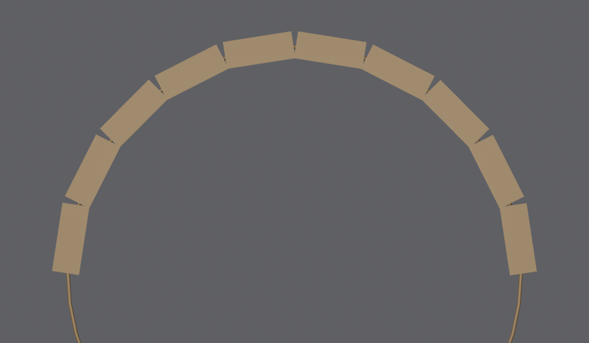
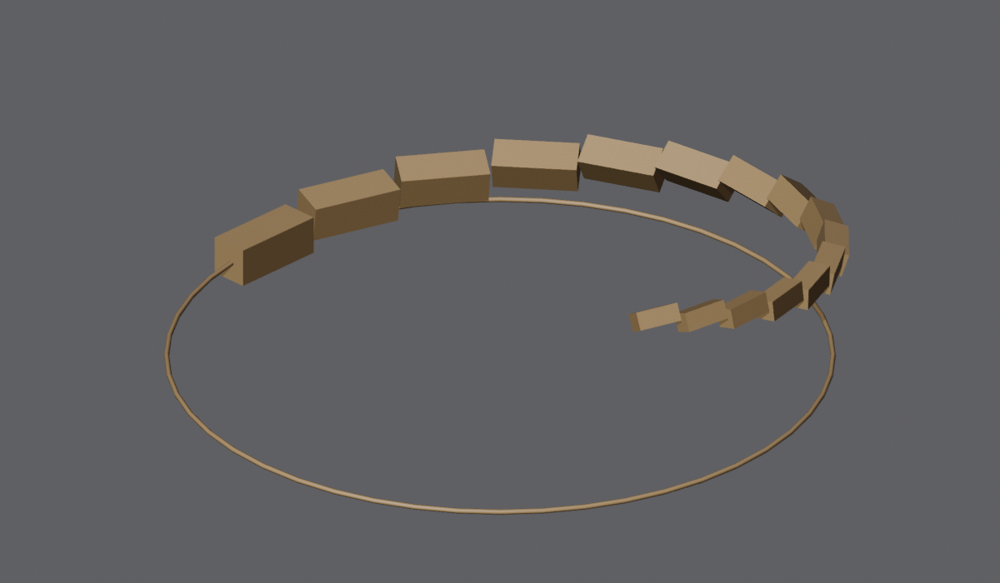
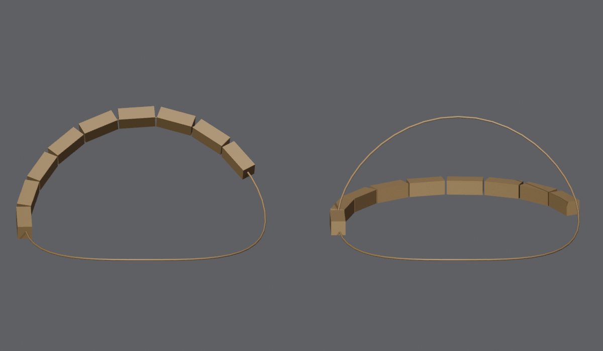

# Array Plus

**Blender's Geometry Nodes Array modifier with exact spacing along curves, per-copy transforms and axis lock.**
For Blender 5.3+ · Free & open source (GPL-3.0-or-later)



Blender's built-in Geometry Nodes Array always spreads copies over the **whole** curve. With Count you get N copies stretched end to end; with Distance you get a copy every X across the full length. There's no way to say *"give me 10 copies, 1 mm apart, and stop there"*.

Array Plus keeps everything the stock Array does (Line, Circle, Curve and Transform shapes, Randomize, Merge, gizmos) and adds:

| Feature | What it does |
|---|---|
| **Count & Spacing** | Exactly *N* copies with an exact **Gap** between them, starting at **Start Offset**. Copies cover only as much of the curve as they need. |
| **Copy Transform** | Offset, rotation and scale in X/Y/Z per copy, either **fixed** (same for every copy) or **accumulated** (each copy adds it again) for spirals, twists, stairs and tapering. |
| **Lock X / Y / Z** | Copies ignore curve points moved along a locked axis, so a curve with lifted points still gives a level, untilted array. |

## Install

### Drag & drop (recommended)

**Drag this link into any Blender 5.3+ window:**

[](https://github.com/hassanziah-byte/array-plus/releases/download/v1.0.0/array_plus-1.0.0.zip?repository=https%3A%2F%2Fgithub.com%2Fhassanziah-byte%2Farray-plus%2Freleases%2Flatest%2Fdownload%2Findex.json&blender_version_min=5.3.0)

or this text link: **[Array Plus 1.0.0 for Blender](https://github.com/hassanziah-byte/array-plus/releases/download/v1.0.0/array_plus-1.0.0.zip?repository=https%3A%2F%2Fgithub.com%2Fhassanziah-byte%2Farray-plus%2Freleases%2Flatest%2Fdownload%2Findex.json&blender_version_min=5.3.0)**

> **First install: drag & drop twice.**
> 1. **First drop:** Blender asks to add the **Array Plus repository** (and to allow online access if it's off). Accept it.
> 2. **Second drop:** drag the same link in again and click **Install**.
>
> After that, a single drop is enough.

 Because the repository is added, Blender will **notify you of new versions** and update Array Plus like any extension from extensions.blender.org.

> Drag the link itself into Blender. Clicking it just downloads the zip, which you can then install manually (below).

### Manual install

1. Download `array_plus-x.y.z.zip` from [**Releases**](../../releases/latest).
2. Drag the zip into Blender, or **Edit → Preferences → Get Extensions → ⌄ (top right) → Install from Disk…**
3. Manual installs don't get update notifications. Use drag & drop for that.

### Use

Select an object → **Add Modifier → Generate → Array Plus**.

## Count & Spacing

Set **Shape: Curve**, pick a **Curve Object**, then **Count Method: Count & Spacing**.

| Input | Meaning |
|---|---|
| **Count** | Exact number of copies |
| **Gap** | Space between copies along the curve (negative = overlap) |
| **Edge to Edge** | On: gap between copy edges (the object's length is added automatically). Off: center-to-center distance |
| **Start Offset** | Where along the curve the first copy sits |

- Closed curves wrap around; on open curves, copies that would run past the end are dropped.
- The gap is measured along the curve. On tight bends, rigid copies' inner corners sit closer than the gap.

## Copy Transform



| Input | Meaning |
|---|---|
| **Accumulate** | **On:** copy *n* gets the value *(n−1)×* (scale compounds: 0.95, 0.95², …), so the first copy is unchanged. **Off:** every copy gets the same value |
| **Copy Offset** XYZ | Along each copy's own axes: X = along the curve (slides, doesn't change spacing). On a flat curve **Y = up** out of the plane and **Z = sideways** (curve normal), matching how the stock Array orients copies. World axes when Align Rotation is off |
| **Copy Rotation** XYZ | Around each copy's own axes |
| **Copy Scale** XYZ | Per-copy scale. With Edge to Edge the gap stays exact as copies grow or shrink |

## Lock X / Y / Z



Locking an axis flattens the curve (points and handles) onto the plane through the curve object's origin on that axis:
- copies keep a constant height and don't tilt up or down slopes;
- spacing follows the flattened path;
- moving the whole curve object still moves the array.

Works with all Curve count methods (Count, Distance, Count & Spacing).

## Tips & limits

- **Beveled/extruded curves don't work as the Curve Object.** A curve with Bevel or Extrude evaluates to a mesh. Use an un-beveled copy as the path (this is the same with the stock Array).
- Edge-to-Edge spacing uses each copy's length along the curve including Local Rotation and Copy Scale, but not Copy Rotation, so large Copy Rotation values can make copies overlap.
- Updating: adding the modifier from a newer Array Plus upgrades older Array Plus node groups in your .blend in place. Modifier values are kept.

## Build from source

The node group is generated by a script that patches Blender's stock Array asset, so it can be rebuilt for new Blender versions.

```sh
# rebuild extension/array_plus.blend from your Blender's bundled geometry_nodes_essentials.blend
./run_blender.sh build_array_plus.py -- extension/array_plus.blend

# package the extension + generate the repository index (dist/index.json) and the drag & drop link
./release.sh
# attach both to the release: gh release upload v<version> dist/array_plus-<version>.zip dist/index.json

# headless checks
./run_blender.sh tests/verify_spacing.py -- extension/array_plus.blend
./run_blender.sh tests/verify_copy_transform.py -- extension/array_plus.blend
./run_blender.sh tests/verify_lock.py -- extension/array_plus.blend
```

`run_blender.sh` runs Blender in the background with an **isolated user profile** (`.blender_isolated/`). Running `blender -b --factory-startup` against your real profile can make Blender's extension wheel sync delete the Python wheels of your installed extensions. Set `BLENDER_EXE` if Blender isn't at the default Steam path.

| Path | Contents |
|---|---|
| `build_array_plus.py` | Patches the stock `Array` group into `Array Plus` |
| `extension/` | The Blender extension (operator, menu entry, bundled node group) |
| `release.sh` | Builds the zip + `index.json` repository listing and prints the drag & drop link |
| `tests/` | Headless verification and README image rendering |
| `reference/ARRAY_ANALYSIS.md` | Breakdown of how Blender's stock GN Array is built |

## License

GPL-3.0-or-later. Built on Blender's bundled "Array" node group asset.
